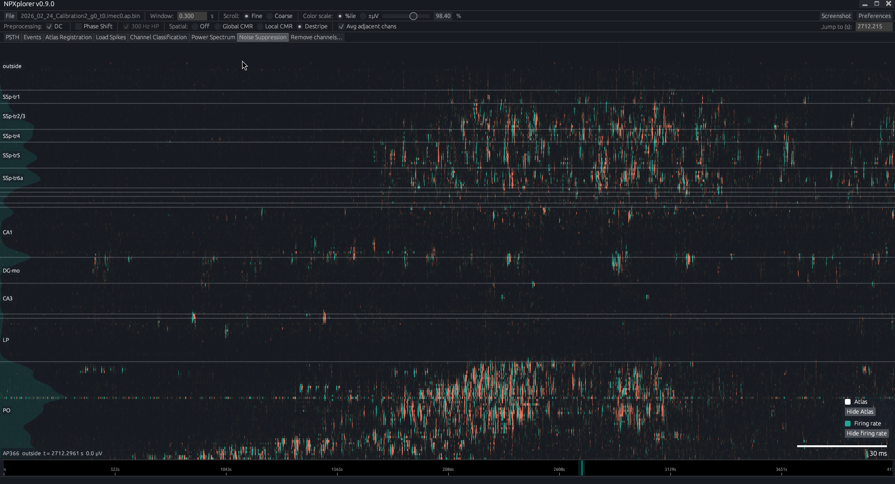

# NPXplorer v0.9.2

NPXplorer is a viewer for raw Neuropixels recordings. It shows the voltage of all channels as a heatmap, laid out by the probe geometry.

With it you can:

- Scroll quickly through the whole recording while the preprocessing runs on the fly.
- View the waveform of a single channel.
- Remove channels and automatically classify bad ones (dead, noisy, outside of the brain).
- Overlay firing rates, events, spike-sorted units and per-channel power spectra.
- Compute peri-stimulus time histograms (PSTH) and current source density (CSD).
- Suppress noise with display filters and notch filters.
- Register the probe to the Allen mouse brain atlas.
- Save screenshots, and export the preprocessed recording for spike sorting.

**This is beta software.** It has not been tested with all recording configurations and probe types.



## Contents

1. [Supported data](#supported-data)
2. [Get started](#get-started)
3. [Navigate](#navigate)
4. [Select and inspect channels](#select-and-inspect-channels)
5. [Set the color scale](#set-the-color-scale)
6. [Remove channels](#remove-channels)
7. [Preprocess](#preprocess)
8. [Firing rate overlay](#firing-rate-overlay)
9. [Channel classification](#channel-classification)
10. [Events](#events)
11. [PSTH](#psth-peri-stimulus-average)
12. [Spike-sorted data](#spike-sorted-data)
13. [Power spectrum](#power-spectrum)
14. [CSD](#csd-current-source-density)
15. [Noise suppression](#noise-suppression)
16. [Notch filters](#notch-filters)
17. [Atlas registration](#atlas-registration)
18. [Screenshot](#screenshot)
19. [Export preprocessed data](#export-preprocessed-data)
20. [Settings and preferences](#settings-and-preferences)
21. [Known limitations](#known-limitations)

## Supported data

- SpikeGLX (`.ap.bin`, `.lf.bin`) with the matching `.meta` file next to it.
- Open Ephys binary format (`continuous.dat`). NPXplorer finds `structure.oebin` and `settings.xml` automatically.
- mtscomp-compressed files (`.cbin` with its `.ch` file).
- Zarr folders written by SpikeInterface (`recording.save(format="zarr")`, Zarr v2). NPXplorer reads the compressors Blosc (with LZ4, Zstd, Zlib or BloscLZ inside), Zstd, GZip, Zlib, LZ4, WavPack and FLAC, and the Delta filter. Blosc with Snappy is not supported. Open with File -> Open Zarr Folder...
- NWB files (`.nwb`, HDF5) with an `ElectricalSeries` in `/acquisition`. 

Zarr and NWB recordings must hold 16-bit integer samples, as the acquisition software wrote them.

Tested with NP 1.0, NP 2.0 single-shank and NP 2.0 multi-shank probes (SpikeGLX), and with a single-shank NP 1.0 recording from Open Ephys. Contact me if you have data that is incompatible.

## Get started

Download the release
or build NPXplorer with Rust stable:

```
cargo build --release
```

To open a recording, click in the center of the app upon launch, or use **File → Open**, pick it from **File → Recent files**, or give it on the command line. A Zarr recording is a folder: use **File → Open Zarr folder…**, or give the folder on the command line.

| Option | Effect |
|---|---|
| `--file <path>` | Opens the recording directly. |
| `--debug` | Writes `debug.log` next to the executable. |

NPXplorer names channels as the recording's metadata does (for example `AP12` for SpikeGLX, `CH13` for Open Ephys). These names appear everywhere in the app and in exported files.

Read the status bar after you open a recording. It lists anything the metadata did not provide, for example an unknown probe type. NPXplorer then assumes the gain and the electrode positions, so µV values and depths are nominal.

## Navigate

| Input | Action |
|---|---|
| Scroll wheel | Move in time. **Fine**/**Coarse** sets the step size. |
| Arrow keys or A/D | Jump half a window. |
| Click the navigation bar (bottom) | Jump to that time. |
| Left-drag on the heatmap | Draw a rectangle to zoom into its channels and time range. |
| Enter | Apply the main action of a window. |
| Esc | Close or go back, one step per press. |

On the navigation bar, the solid marker shows the displayed window. The shaded area shows the part that is already preprocessed.

While you drag a zoom rectangle, the readout at the bottom left shows its channels and time range. You can zoom again inside the zoomed view.

## Select and inspect channels

- **Alt + left-click** a row to select a channel.
- **Alt + right-click** a row to select a second channel. The top right then shows the vertical distance between the two (Δ µm).
- **Right-click** a row to open a menu with **View waveform** and **Remove channel**.

**View waveform** shows the trace of that channel. In the waveform view:

- **Alt + scroll** changes the vertical scale.
- The readout at the bottom left shows the time and voltage of the hovered point.
- **Left-drag** a rectangle to zoom into its time and voltage range. Esc returns to the view before the zoom.
- Esc or ✖ returns to the heatmap.

## Set the color scale

Choose one of two modes. **Alt + scroll** adjusts either.

- **%ile**: the color range follows a percentile of the values within ±1 s of the centre of the view. If the view is longer than that, it uses the whole view.
- **±µV**: a fixed range.

**Peak pooling** (Preferences, off by default) helps with long time windows, where one pixel column covers many samples. When it is on, each pixel shows the sample with the largest magnitude, so spikes keep their amplitude at any window length. In **%ile** mode, the color range then follows the values on screen. When it is off, each pixel shows the mean, which gives a smoother picture and is better for LFP.

## Remove channels

**Remove channels…** excludes channels from the display and from all processing.

- Enter channel IDs or ranges, separated by commas, for example `AP3,AP17,AP40-AP50`.
- A bare number (`17`, `40-50`) matches the channels whose ID ends in that number.
- **Load from file…** reads the list from a file. It uses a layout file like the one for the PSTH (see [Event file layout](#event-file-layout)): `channel_remove_layout.csv` next to the list file, or the default in `config/`.

When you open a recording for the first time, the list already contains the reference sites of the probe. They carry no neural signal, and NPXplorer removes them before any preprocessing. It takes them from the metadata: the sites that SpikeGLX marks as unused in its geometry map, or the sites that Open Ephys lists without a position. If the metadata marks none, it takes them from the probe type (channel 191 on NP 1.0, none on NP 2.0). **Reset** includes them again.

NPXplorer saves the list with the settings of the recording.

## Preprocess

The preprocessing bar has these switches:

| Switch | Effect |
|---|---|
| **DC** | Removes the mean of each channel. |
| **Phase Shift** | Corrects the sampling delay between channels. |
| **Notch (n)** | Switches the notch filters off and on. It appears when you have set up at least one (see [Notch filters](#notch-filters)). |
| **300 Hz HP** | Zero-phase highpass filter. It is always on with Destripe. |
| **Spatial** | **Global CMR**, **Local CMR**, **Destripe** (IBL-style) or **CSD**. |
| **Avg adjacent chans** | Averages the channels at the same depth into one row. |

The spatial filters:

- **Global CMR** subtracts the median of all channels of the shank.
- **Local CMR** subtracts the median of nearby channels.
- **Destripe** is the IBL-style filter. It never mixes channels across a gap in the layout (drawn as a dotted line) or across shanks.
- **CSD** shows current source density (see [CSD](#csd-current-source-density)).

NPXplorer applies the notch filters after the DC removal and before the highpass.

## Firing rate overlay

A bar on the left of the heatmap shows the number of threshold crossings per channel in the displayed window. Set the threshold, the scale and the depth smoothing in Preferences.

## Channel classification

Adapted from IBL. The classification marks channels with a colored stripe:

| Color | Channel |
|---|---|
| Magenta | Dead |
| Red | Noisy |
| Green | Outside of the brain |

NPXplorer classifies each shank on its own, with the channels in depth order. It skips removed channels.

Two settings in Preferences control it:

- **Outside of brain** chooses how NPXplorer finds the brain surface. **Adaptive** (default) is IBL's adaptive mode and finds weaker surfaces, for example in LFP data. **Fixed threshold** is IBL's default and is stricter.
- **Chunks to sample** sets how many snippets of the recording it uses. More snippets are more reliable but slower.

## Events

The **Events** window shades the events on the heatmap and on the waveform view. It uses the color of the firing rate overlay, and the legend lists them as **Events**.

1. Choose an event file with onset times in seconds.
2. If needed, edit the layout in the **File format** field (see below).
3. Press **Load**.

Offsets come from the `f` column(s) of the event file. Without such a column, each shaded area is **Duration (ms)** long. **Emphasize on/offset** draws a thin line at each onset and offset.

### Event file layout

A layout tells NPXplorer how to read the event file. The lines of the layout mirror the lines of the event file:

- A line without an `o` is a header row to skip.
- The first line with an `o` marks the columns. `o` = onset times, `f` = offset times (used by the Events window), `x` = ignore. Trailing x's are not required.
- A line that starts with `#` is a comment.

For example, this layout skips one header row, reads onsets from the first column and reads offsets from the second:

```
header
o,f,x
```

The Events window and the PSTH window share the layout. NPXplorer saves your edits with the settings of the recording. It never changes the default in `config/`. **Reset to default** restores the default.

### Which event file opens

NPXplorer saves the event file that you last loaded in the Events or PSTH window with the settings of the recording. When you open the recording again, it fills in that file. It does not load the file until you press **Load** or **Apply/Compute**.

If the recording has no saved event file, NPXplorer fills in the default event file from **Preferences → Default file locations…**, if that file exists. Tick **Load on start → Events** there to load the event file when the recording opens. NPXplorer then loads the recording's own event file, or else the default.

## PSTH (peri-stimulus average)

The PSTH window averages the signal around event onsets. It uses all channels that are not removed and the preprocessing of the main window.

1. Choose an event file. The window reads it with the [event file layout](#event-file-layout).
2. Optional: select up to two channels on the heatmap (left-click and right-click).
3. Press **Apply/Compute**. NPXplorer computes nothing before that.

The window shows a heatmap, the mean over all channels, and the traces of the selected channels. **Alt + scroll** over the window adjusts the color scale. NPXplorer scales the traces to fit when it computes them. After that, they zoom together with the color scale.

The PSTH is much faster without a spatial filter. The result is identical.

## Spike-sorted data

**Load Spikes** shows the units of a phy folder as dots on the heatmap. Kilosort, iblsorter and other sorters that write the phy format produce such a folder.

1. Check the folder. It starts as the default from **Preferences → Default file locations…** (`ks` next to the recording, unless changed). **Browse…** picks another.
2. Set the filters under **Filter neurons**.
3. Press **Load**.

After the load, **Apply** only runs the filters again. It reads the cluster tables again, so it picks up labels that you changed in phy. To load the folder and apply the filters when the recording opens, tick **Load on start → Spike-sorted data** in Preferences.

### Filter the units

NPXplorer keeps the units that pass three filters, in this order:

1. **Curation label (group)**: the manual label from phy (`cluster_group.tsv`). Choose **good** (default), **good + mua** or **all** (which includes noise and unsorted). If the sorting is not curated yet (no `group` column), NPXplorer skips this filter. A note in the window and in the legend says so.
2. **Kilosort label (KSLabel)**: the automatic label from Kilosort (`cluster_KSLabel.tsv`), with the same choices (default **all**). Units that you created with a merge or a split in phy have no KSLabel, so **good** and **good + mua** drop them.
3. **User**: any column of the cluster tables, for example a label added in phy or a column of `cluster_info.tsv`. Leave **Column** empty to skip this filter.

For the **User** filter, **Value** can be:

- one text, or several texts separated by commas (`Th,CA1`)
- a comparison with a number (`>50`, `<=10`, `=3`, `!=0`)

NPXplorer finds a column by its header in any `cluster_*.tsv` in the folder. The single-column files take precedence over `cluster_info.tsv`. It ignores copies such as `cluster_info (copy 1).tsv`.

If NPXplorer does not find a column or a value, or if no units are left after a filter, the window says so. The spikes shown so far stay.

NPXplorer saves the folder and the filters with the settings of the recording. A recording that you open for the first time starts with the filters that you used last.

### Read the display

- Each spike is a dot at its time, on the channel where its template is largest.
- With more than 20,000 spikes in the view, NPXplorer draws none, and the legend asks you to zoom in.
- The legend lists the number of units shown. **Show spikes**/**Hide spikes** there toggles the dots.
- NPXplorer draws spikes in the LF view too.

### Required files

NPXplorer reads `spike_times.npy`, `spike_templates.npy`, `templates.npy`, `channel_map.npy`, `params.py` (sample rate, channel count) and the cluster tables. If they are present, it also reads `spike_clusters.npy` (curated clusters), `templates_ind.npy` (sparse templates) and `whitening_mat_inv.npy`.

The sorting must come from the open file, or from a file with the same channels. NPXplorer refuses a folder with a different channel count in `params.py`, for example an export with channels removed.

## Power spectrum

**Power Spectrum** computes the power spectral density of each channel (Welch's method). It shows the result as a second heatmap to the right of the main one.

Set these options, then press **Calculate**:

| Option | Choices |
|---|---|
| **Time scope** | **Whole recording (chunks)** (default) averages evenly spaced snippets from the whole recording. **Chunks to sample** (default 100) sets how many. **Current view window** follows the view as you scroll or zoom. |
| **Source** | The raw voltage, or the currently preprocessed signal. The preprocessed signal is available in the current-view scope only. The whole-recording scope always uses raw. |
| **Scaling** | Linear power or **dB** (default). |
| **Colour range** | **Global** (default, one range for all channels) or **Per-channel**. |
| **Restrict frequency range** | Limits the displayed and colored band to a range in Hz. Off shows the full band up to Nyquist. |
| **Restrict time window** | Whole-recording scope only. Takes the chunks from a chosen part of the recording. |

The whole-recording scope shows a progress bar, and you can abort it. The current-view scope computes again when the scroll stops.

The spectrum heatmap has one row per channel. The rows align with the rows of the main heatmap, also when you zoom. Frequency is on a log x axis with four tick labels, and color shows power.

After the calculation, **Show Spectra**/**Hide Spectra** in the legend toggles the overlay. The other overlays have Show/Hide entries there too, once they have something to show.

## CSD (current source density)

CSD shows current source density along depth. It works for AP and LF files.

1. Choose **CSD** as the spatial filter. A small window opens.
2. Set **Gaussian smoothing** and **Bandpass**.
3. Press **Apply** or Enter to switch CSD on. Esc cancels.

| Option | Default | Advice |
|---|---|---|
| **Gaussian smoothing** along depth, with **σ** | On, 40 µm | For LFP, use 40 to 80 µm. Below about 30 µm, the result is mostly noise. |
| **Bandpass** (zero-phase Butterworth, order 3 at each edge) | On, 5–150 Hz, as in the Allen Brain Observatory Neuropixels CSD | For slow oscillations, lower the low cut to about 1 Hz. |

The bandpass replaces the 300 Hz HP. Use the bandpass for LFP sinks and sources. Without it, AP data gives a spike-band Laplacian. NP 1.0 AP data was usually highpassed in hardware (see the last field of each `~imroTbl` entry in the meta file). NP 2.0 AP data is wideband.

NPXplorer shows the values as −∂²φ/∂z² in **mV/mm²**, so sinks are negative. It assumes no tissue conductivity. Multiply by σ ≈ 0.3 S/m to get µA/mm³.

While CSD is on:

- The color scale, the hover readout, the waveform view and the PSTH use mV/mm².
- CSD has its own color settings: percentile 80–100 % (default 95 %), or a fixed range of 0.1–1000 mV/mm² (default ±10). When you switch CSD off, the µV settings come back.
- **Avg adjacent chans** is on (one row per depth). With the bandpass, the 300 Hz HP is off. When you choose another spatial filter, NPXplorer restores both.
- NPXplorer hides the firing rate overlay and refuses to export.

A strong pair of sink and source, for example at the brain surface, can leave the rest of the heatmap dark. If this occurs, lower the percentile or remove the channels outside the brain.

## Noise suppression

**Noise Suppression** opens a window with display filters. These filters change the heatmap, the waveform view and the hovered µV value. They do not change the firing rate, the PSTH, the spectrum or the export.

- Press **Apply** to make your changes take effect.
- **Disable all** switches every filter off at once and keeps the values.
- The button is highlighted while a filter is on.
- NPXplorer saves the applied settings with the settings of the recording.

In **%ile** color mode without peak pooling, the color range still comes from the unfiltered signal. You can thus compare the filtered and the unfiltered view directly.

The filters run in the order below.

### Wavelet denoising

This filter splits each channel into scales with a wavelet and removes small coefficients at each scale.

| Setting | Default | Meaning |
|---|---|---|
| Wavelet | | Haar, db4 or sym4. |
| **Levels** | 2 | The number of scales. |
| **Threshold** | 3 × σ | A multiple of the noise level of each scale. |
| **Hard** / **Soft** | Soft | **Hard** removes the coefficients below the threshold. **Soft** shrinks all coefficients toward 0 by the threshold. |

### Attenuate isolated events

This filter reduces events that appear on too few neighbouring channels. An event is a stretch of the signal between two zero crossings whose peak reaches **Event level**.

| Setting | Default | Meaning |
|---|---|---|
| **Event level** | ±15 µV | The peak that makes a stretch an event. |
| **Min. adjacent channels** | 3 | The filter keeps an event that spans at least this many neighbouring channels. The count includes the channel of the event. |
| **Neighbour amplitude** | 90 % | Each neighbour must reach this share of the peak, with the same polarity. |
| **Time tolerance** | ±0.3 ms | The neighbour must reach it within this time. |
| **Attenuation** | 50 % | The filter reduces every other event by this amount. 100 % removes the event. |

As with Destripe, channels across a gap in the layout are not neighbours.

### Soft-knee noise gate

This filter scales every sample by a smooth S-shaped function of its amplitude. Weak signals fade and strong signals stay. Unlike a hard threshold, it has no jump.

| Setting | Default | Meaning |
|---|---|---|
| **Centre** | 20 µV | The amplitude that gets half of **Max gain**. |
| **Width** | 5 µV | The sharpness of the transition. The gain goes from 12 % to 88 % within Centre ± 2 widths. |
| **Max gain** | 1× | The gain for strong signals. |

A max gain above 1 is the same as a narrower color range. In **%ile** mode, strong signals then saturate.

## Notch filters

The notch filters are in the lower part of the **Noise Suppression** window. Unlike the display filters, they are part of the preprocessing: they change the data everywhere, not only on the display.

1. Press **Find noise peaks**. NPXplorer scans chunks of about 1 s across the recording. A progress bar shows the scan, and **Abort** stops it.
2. Read the result. A plot shows the mean spectrum of each shank, and a table lists the peaks found.
3. Tick a peak to add a notch, or add a notch by hand.
4. Press **Apply notches** to activate them on all channels.

The scan uses the current preprocessing without the notches. It looks at the spectrum of every channel on its own. It thus also finds noise that reaches only some channels, or reaches the channels at different times. CMR and Destripe cannot remove such noise.

These settings control which peaks the table lists:

| Setting | Default | A peak is listed if |
|---|---|---|
| **Chunks to sample** | 100 | (The number of chunks in the scan.) |
| **Min. channels** | 30 % | It is a peak on at least this share of the channels of one shank. |
| **Min. prominence** | 6 dB | It is at least this far above the smoothed spectrum. |
| **Max. width** | 3 Hz | It is at most this wide. |
| **Min. presence** | 25 % | It is present in at least this share of the chunks. |

The table leaves out broad peaks, which are usually brain oscillations. It also leaves out peaks that come and go, such as stimulation artifacts. A filter on the whole recording is the wrong tool for those.

The table shows evenly spaced lines (at least 3, for example a carrier with mains sidebands every 50 Hz) as one row. The checkbox of that row adds a notch for each line. Hover over the row to list the lines.

NPXplorer saves the notches with the settings of the recording, separately for AP and LF. It restores them when you open the file again. **Notch (n)** in the preprocessing bar switches them off and on.

## Atlas registration

Atlas registration draws the borders between brain regions of the Allen mouse atlas (CCF 2017, 10 µm) on the heatmap. It computes them from the insertion coordinates of the probe.

### Set up the atlas

1. Create a folder and set it in **Preferences → Default file locations…**.
2. Download `annotation_10.nrrd` from the [Allen Institute](https://download.alleninstitute.org/informatics-archive/current-release/mouse_ccf/annotation/ccf_2017/) into the folder.
3. Save the structure ontology from the [Allen API](https://api.brain-map.org/api/v2/data/query.csv?criteria=model::Structure,rma::criteria,[ontology_id$eq1],rma::options[order$eq%27structures.graph_order%27][num_rows$eqall]) as `query.csv` in the folder.

On the first load, NPXplorer converts the `.nrrd` once into `annotation_10_npxplorer.npy` (2.4 GB) and `annotation_10_npxplorer_ids.txt` in the same folder. This takes a while and needs write access to the folder.

You can also use the reformatted atlas of the [Neuropixels Trajectory Explorer](https://github.com/petersaj/neuropixels_trajectory_explorer): `annotation_volume_10um_by_index.npy` and `structure_tree_safe_2017.csv` ([download](https://osf.io/fv7ed/)). It has the same voxels and borders, and it loads without the conversion.

### Enter the insertion

| Field | Meaning |
|---|---|
| **Insertion** AP and ML | In mm from bregma. AP positive = anterior, ML positive = right. |
| Angles as **Azimuth / elevation / rotation** | Azimuth from the lambda→bregma axis, elevation from horizontal. |
| Angles as **Polar / azimuth / roll** | Polar angle from vertical, azimuth from +ML. |
| **Depth** | From the brain surface to the tip, along the probe. |
| Tip offset | The distance from the tip to the first electrode row. The default comes from the probe type: 209 µm for NP 1.0, 206 µm for NP 2.0. |
| **Bregma–lambda distance** | Scales the atlas to the animal. Default 4.1 mm. |

Rotation or roll turns the probe around its axis. This matters for multi-shank probes.

### Match the borders to the data

- **Alt + drag** any border to move all borders together. This changes the depth.
- **Drag** a single border to move only that one. It stops at its neighbours.

NPXplorer keeps dragged borders when the depth changes. Only **Reset borders** undoes them.

### Read and save the regions

- Hover over a region label to see its full name.
- The readout at the bottom left shows the region of the hovered channel.
- With channels ordered by ID, NPXplorer hides the borders and labels.
- **Skip drawing regions with less than … channels** (default 4, 0 draws all) hides small regions. NPXplorer splits their channels between the neighbouring regions on the display. The readout and **Save** still use the exact regions.

**Save** writes `<recording>_regions.csv` next to the data file, with the ID and the region of each channel.

NPXplorer saves the coordinates and the dragged borders with the settings of the recording. The AP and LF files share them. If the overlay was visible when you closed the recording, NPXplorer loads the atlas and draws the borders again when you open it.

## Screenshot

1. Press **Screenshot** (top right). A window lists the overlays calculated so far (events, spikes, atlas regions, firing rate, power spectrum, channel classification), the lines of the selected channels and the scale bar.
2. Tick the items to include.
3. Press **Save…** and give a file name.

NPXplorer saves the plot area as a PNG at screen resolution. The plot area is the heatmap with the spectrum panel, or the waveform view. The image has no windows, no legend and no hover readout. The window closes after the save.

## Export preprocessed data

**File → Export preprocessed data…** writes a copy of the recording with the current preprocessing applied. The copy has the format of the original:

- SpikeGLX: a `.bin` with its `.meta`.
- Open Ephys: a session folder with `settings.xml`, `structure.oebin`, `continuous.dat`, the timestamps cut to the exported range, and the events.

The export contains all channels that are not removed, in their original order, with their original names and their original µV per bit. NPXplorer copies the SpikeGLX sync channel unchanged. Noise suppression is a display filter, so the export does not contain it.

### Export options

- **Time range** (**From**/**To**, in s): **Whole recording** or **Current view**. The exported file starts at **From**. NPXplorer shifts SpikeGLX's `firstSample` to match, and Open Ephys timestamps keep their values. The export thus stays aligned with other streams.
- **Bad channels**: you can keep, remove or interpolate dead channels and noisy channels, each from their neighbours. You can remove channels outside the brain. This option uses the channel classification and runs it first if needed.
- **Average same-depth channels** (off by default). This breaks spike sorting.
- **Event blanking**: changes the data around each event of the **Events** window. **Blank** sets the data to 0. **Interpolate** bridges it with a straight line. The window goes from **Start** to **End** (ms, relative to the onset).
- **Around offsets**: adds a second blanking window around each offset. If the event file has no offset column, the offset is the onset plus **Event length**.
- **Write probe file for Kilosort 4**.
- **Open export when done**.

**Check the classification overlay before you remove or interpolate bad channels.** The outside-of-brain detection can be wrong.

**Average same-depth channels changes the probe geometry.** It breaks spike sorters and most other analyses.

Event blanking runs before the notch, the highpass and the spatial filter, so these filters do not spread the artifact.

### Run the export

1. Press **Export…**. A save dialog opens with a proposed name.
2. Confirm the name. You cannot overwrite the original.

The dialog opens in the export folder from **Preferences → Default file locations…**, if one is set. NPXplorer creates that folder if needed. Otherwise the dialog opens next to the original.

The proposed name is the name of the original with `_preprocessed` and the time range added, for example `run_preprocessed_120-300s_g0_t0.imec0.ap.bin`.

During the export, the window is frozen and greyed out, and NPXplorer uses all CPU cores. **Abort** stops the export and removes what it wrote.

### Files next to the export

| File | Content |
|---|---|
| `<name>.preprocessing.toml` (Open Ephys: `preprocessing.toml` in the session folder) | The source, the time range, the channels exported, removed and interpolated, and every step applied with its parameters, in order. |
| `<name>.npxplorer.toml` | Settings to open the export in NPXplorer. Preprocessing is off, because it is in the data now. The atlas registration is carried over. |
| `<name>.events.csv` | The events in the exported range, with times relative to its start. Written if an event file is loaded. |
| `<name>.kilosort4_probe.json` | Channel positions and shanks in the probe format of Kilosort 4. Written if ticked. |

## Settings and preferences

### Settings of a recording

NPXplorer saves every setting that you make for a recording in `<recording>.npxplorer.toml` next to the data file. It applies them when you open the recording again. This covers the main window and the tool windows:

- preprocessing, color scale and time window
- removed channels, noise suppression and notches
- overlays, power spectrum and classification
- events, PSTH and atlas registration

- The AP and LF files of a recording share the file. Settings that differ between the bands are kept separately. The removed channels, the event settings and the atlas settings are shared.
- NPXplorer does not recompute the power spectrum, the channel classification or the PSTH when you open a recording. It restores their settings only.
- NPXplorer reads files from earlier versions (`.npx_atlas.toml`, `.npx_notch.toml`) and replaces them with the new file.

### Preferences

NPXplorer saves the preferences in `config/npxplorer_prefs.toml` next to the executable. The default layout files for PSTH and Remove channels are in the same folder.

The preferences hold the settings that do not belong to one recording: the atlas folder, the buffer and memory limits, and the recent files. They also hold the settings that you used last. A recording that you open for the first time starts with those.

### Default file locations

**Default file locations…** (top of Preferences) sets where NPXplorer looks for the files that belong to a recording.

| Entry | Default |
|---|---|
| **Event file** | |
| **Spike-sorted data** folder | `ks` |
| **Export folder** | Empty: next to the recording. |
| **Atlas folder** | |

- Paths are relative to the folder of the recording. `..` goes up a folder, for example `../ks`. Absolute paths work too.
- For Open Ephys, the folder of the recording is the one that holds `continuous.dat`.
- **Load on start** loads the events, the spike-sorted data or both when you open a recording.

### Performance

The **Performance** section in Preferences controls how much of the recording NPXplorer keeps preprocessed. Experiment with it to find good settings for your computer.

| Setting | Default | Effect |
|---|---|---|
| **Preprocess around view (s)** | 10 s | NPXplorer computes this much on both sides of the view first. |
| **Background preprocessing** | Off | NPXplorer continues to preprocess while nothing else needs computing. It goes about three times further in the scroll direction than behind. |
| **Memory budget** | 50 % | Background preprocessing stops when the cache uses this share of the available memory. |
| **Memory reserve** | 1500 MB | Below this much free memory, NPXplorer drops the data farthest from the view. |

Background preprocessing pauses while Power spectrum, Classification, PSTH or Export run.

One second of preprocessed NP1 AP data takes about 11.5 MB with averaged channels, and twice that without.

## Known limitations

- `.cbin` files, Zarr folders and NWB files are slower to navigate, because NPXplorer decompresses them on the fly. NWB files are the slowest: they usually store long chunks (about 30 s), and NPXplorer must decompress a whole chunk to show a part of it.
- Zarr and NWB: **Export preprocessed data** is not available.
- Zarr: NPXplorer takes the electrode positions and the probe type from the probe that SpikeInterface stored with the recording. Without a stored probe, it assumes a single column at 20 µm and cannot correct the sampling delay (**Phase Shift**). The status bar says so.
- Zarr: NPXplorer shows only the first segment.
- Zarr with lossy WavPack (`bps` set): the decoded values can differ by a few ADC counts from the values that the WavPack reference decoder gives. Lossless WavPack is exact.
- NWB: NPXplorer needs the columns `rel_x` and `rel_y` in the electrodes table for the electrode positions, and the column `inter_sample_shift` for **Phase Shift**. Without them, it assumes a single column at 20 µm and applies no delay correction. If the file holds several electrical series, NPXplorer shows the one with the highest sample rate.
- NWB files with a Zarr backend are not supported.
- Open Ephys: NPXplorer uses only the first probe of a `settings.xml` processor. Multi-shank probes and sessions with several experiments or recordings are untested.
- Open Ephys export: if you remove channels, the export rewrites the channel lists of the probe in `settings.xml`. This is not checked with SpikeInterface/probeinterface yet.
- SpikeGLX recordings older than 20230202 have no `~snsGeomMap`. NPXplorer then rebuilds the electrode positions from `~snsShankMap` and the pitch of the probe type.
- For an unknown probe type, NPXplorer falls back to a nominal single column at 20 µm and shows a warning in the status bar.
